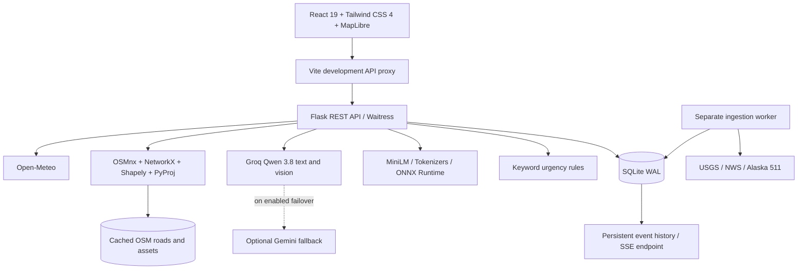

# EmergencyCore 2.0

### AI-assisted disaster intelligence, infrastructure simulation, and adaptive routing

EmergencyCore 2.0 brings community reports, public disaster feeds, local semantic analysis, hosted AI advisory, and road-network simulations into one human-led response workspace. Operators can review reports, inspect evidence, simulate road disruptions, and compare candidate routes as scenario conditions change.

**Created by Abdullah Siddique** · [Portfolio](https://abdullah-siddique-dev.netlify.app/) · [LinkedIn](https://www.linkedin.com/in/mr-abdullah-siddique/) · [GitHub](https://github.com/abdullah90907)

> A working local prototype for decision support and demonstrations. It does not dispatch emergency services, verify damage automatically, or guarantee safe evacuation routes. The Anchorage demonstration combines an official earthquake event, modern OSM roads, and explicitly simulated closures—not an exact reconstruction of 2018 damage.


[Feature screenshots](screenshots/README.md) · [Detailed backend/API guide](docs/BACKEND_2_IMPLEMENTATION.md) · [Verification notes](docs/VERIFICATION.md) · [Frontend setup](frontend/README.md)

## What the project does

| Feature | Implemented behavior |
|---|---|
| Operations overview | Incident counts, active/resolved states, recent reports, connection and local-model availability |
| Incident desk | Create reports, search loaded reports, filter by status, inspect details, and progress through a review workflow |
| Priority signals | Keyword rules flag terms such as trapped, unconscious, collapsed, and stranded; results require human review |
| Local semantic intelligence | Quantized MiniLM embeddings suggest categories and rank related reports on CPU |
| Hosted text advisory | Groq Qwen provides summaries, unknowns, and resources to consider; output identifies the answering model/provider |
| Optional photo assessment | Configured vision provider describes visible conditions; expert structural inspection remains necessary |
| Weather watch | Coordinate lookup for Open-Meteo modeled current conditions and hourly precipitation probabilities |
| Disaster feeds | Explicit USGS/NWS ingestion, cached records, timestamps, source evidence and ingestion status |
| Region map | MapLibre context map, cached road overlay, region readiness, layer toggles, navigation and route endpoint pins |
| Isolated scenarios | Simulation, historical and live contexts with scenario-specific observations and graph-version pinning |
| Adaptive routing | Directed/parallel-edge handling, explicit blocked-edge exclusion, baseline/adapted routes, alternatives and modeled time differences |
| Replay | Reconstruct asset states at a selected observation timestamp and recalculate routes |
| Evidence tracking | Official, Community-Reported, AI-Estimated and Simulated provenance with timestamps and verification status |
| Exposure API | User-defined polygon intersections with available assets, distinct from observed damage or damage prediction |
| Alaska 511 | Key-based road-event ingestion and unverified nearest-road matching candidates; closures are not automatically applied |

The React interface refreshes workspace data every 12 seconds while visible. The backend exposes persistent Server-Sent Events; direct frontend SSE consumption remains pending. Provider feeds update only when explicitly refreshed or when the separate ingestion worker is running.

## Screenshots and feature walkthrough

Screenshots live in [`screenshots/`](screenshots/README.md), with descriptions and capture metadata in [`manifest.json`](screenshots/manifest.json). They use an isolated database and labelled demonstration reports. No real emergency is claimed. External basemap tiles are disabled in automated map captures; the screenshots show actual cached road overlays.

| Workspace | Preview |
|---|---|
| Incident reporting and review | [Incident desk](screenshots/02-incident-desk.png) · [Report form](screenshots/04-report-form.png) · [Analysis](screenshots/05-report-analysis.png) · [Related reports](screenshots/07-related-reports.png) |
| AI intelligence | [Text/vision workspace](screenshots/08-ai-and-vision-workspace.png) · [Groq result](screenshots/09-groq-text-result.png) |
| Weather | [Lookup](screenshots/10-weather-input.png) · [Provider result](screenshots/11-weather-result.png) |
| Disaster map | [Road network](screenshots/12-road-network.png) · [Route comparison](screenshots/13-routing-comparison.png) · [Replay](screenshots/14-historical-replay.png) |
| Availability and connection | [Unprepared region](screenshots/15-region-unavailable.png) · [Connection settings](screenshots/16-connection-settings.png) |
| Responsive layouts | [Mobile overview](screenshots/17-mobile-overview.png) · [Navigation](screenshots/18-mobile-navigation.png) · [Routing](screenshots/19-mobile-routing.png) |


## Technical architecture



The Vite proxy is for development. A production reverse proxy must route `/api` to Flask and serve the built frontend. All hosted-model credentials remain on the backend.

### Frontend

- **React 19** implements dashboard, report dialogs, review actions, AI results, weather and the map workspace.
- **Tailwind CSS 4** and custom CSS provide coral/ivory/blue styling, glass surfaces, layered animation and responsive layouts. Reduced-motion preferences disable decorative animations.
- **MapLibre GL** renders an attributed geographic basemap and cached GeoJSON overlays. Its web worker is bundled explicitly through Vite.
- The map workspace is **lazy-loaded** instead of shipping its full JavaScript with the initial dashboard.
- Region changes cancel obsolete road requests and clear scenario results, endpoints and selected edges. Missing data disables unsupported operations rather than leaving stale geometry on screen.
- Optional operator authentication uses a token held in tab-scoped session storage. The UI is intended for a trusted local operator, not public authentication for multiple users.

### Backend and storage

- **Flask application factory** separates configuration, database setup, additive migrations, routes and services.
- **SQLite WAL** stores incidents, events, normalized disasters, ingestion health, scenarios, observations, traffic snapshots and route results. New schema is added without replacing original incident tables.
- **Waitress** serves Flask on Windows. Long-lived SSE connections occupy worker threads; larger deployments need dedicated streaming capacity.
- **NetworkX MultiDiGraph** preserves direction and parallel road edges. Baseline and adapted paths use modeled travel-time weights; blocked/unavailable directed edges are excluded from adapted routing.
- **Shapely/PyProj** perform metric distance matching and geometric intersections. **OSMnx/GeoPandas** prepare regional road/building/facility datasets outside normal requests.
- Scenario state comes from the latest observations at or before the requested replay time. Observation time and system recording time are stored separately.

### AI responsibilities

| Component | Role | Important limitation |
|---|---|---|
| `Xenova/all-MiniLM-L6-v2` | Local text embeddings, prototype category similarity, related-report ranking | General English embedding model; not disaster-trained. Similarity is not confidence. Text is truncated to 256 tokens. |
| `qwen/qwen3.8-27b` on Groq | Optional report advisory and image descriptions | Must be grounded in submitted evidence; cannot verify casualties, structural safety or dispatch |
| `gemini-3.8-flash` | Optional alternate provider for text/images | Backup integration exists, but has not been verified reliable; disabled in the current local environment |
| Keyword rules | Transparent critical-language signals independent of hosted AI | Cannot reliably understand negation, missing context or all hazards |

Hosted inference has timeouts and explicit provider/model provenance. When enabled, fallback can forward the same report/image to Gemini after a primary failure; provider content-filter refusals do not trigger fallback. Missing or failed hosted AI preserves local triage rather than fabricating output. Images are validated, resized and converted to JPEG before provider transmission; uploaded images are not retained as image files by this backend.

### Data flow

1. A report arrives through the UI and is validated by Flask.
2. Local rules identify critical terms; MiniLM generates semantic suggestions. Optional hosted AI adds an advisory.
3. The incident and its event are persisted together; an operator reviews it.
4. Disaster ingestion separately normalizes provider records with source and freshness information.
5. Within an isolated scenario, an operator records a road or asset state with evidence and timestamps.
6. Routing compares the pinned network with the scenario-adjusted network and persists the comparison.
7. The interface displays paths, exclusions, replay state and model/source limitations.

## Repository layout

```text
EmergencyCore-main/
├── app.py                         Root Flask compatibility entry point
├── requirements.txt               Delegates to backend requirements
├── backend/
│   ├── run.py                     Flask development entry point
│   ├── .env.example               Shareable configuration template
│   ├── requirements.txt           API + routing dependencies
│   ├── requirements-models.txt    ONNX / tokenization dependencies
│   ├── requirements-geo.txt       OSM preparation dependencies
│   ├── emergencycore/
│   │   ├── __init__.py            Application factory
│   │   ├── config.py              Environment configuration
│   │   ├── database.py            Connections and initial schema
│   │   ├── migrations.py          Additive intelligence schema
│   │   ├── api/
│   │   │   ├── routes.py          Reporting, models, weather, events
│   │   │   └── intelligence.py    Disasters, regions, scenarios, routes
│   │   └── services/              Analysis, semantic, disaster, region,
│   │                              geospatial, impact, traffic, routing,
│   │                              simulation and decision services
│   ├── scripts/                   Setup, ingestion, imports and demo
│   ├── tests/                     API, routing and provider failover tests
│   ├── models/                    Downloaded local weights (ignored)
│   ├── data/                      Cached regional layers (ignored)
│   └── instance/                  Runtime SQLite database (ignored)
├── frontend/
│   ├── src/App.jsx                Main workspaces and report dialogs
│   ├── src/DisasterWorkspace.jsx   Map and scenario UI (lazy-loaded)
│   ├── src/api.js                 Shared API client
│   ├── src/styles.css             Dashboard styling
│   ├── src/disaster.css           Map workspace styling
│   └── vite.config.js            Build plugins and API proxy
├── screenshots/                   Feature gallery and manifest
└── docs/                          API, backend and verification guides
```

## Local setup

Prerequisites: Python 3.11+ (tested locally with 3.13), a current Node.js LTS compatible with the installed dependencies, npm, and a browser with WebGL/hardware acceleration. Internet is needed for the initial model/data downloads and external provider requests; local MiniLM inference needs no API key or GPU.

Run from the project root in PowerShell:

```powershell
python -m venv .venv
python -m pip --python .venv/Scripts/python.exe install -r backend/requirements-models.txt -r backend/requirements-geo.txt
# First setup only: do not overwrite an existing private configuration.
Copy-Item backend/.env.example backend/.env
.\.venv\Scripts\python.exe backend/scripts/setup_model.py
.\.venv\Scripts\python.exe backend/run.py
```

In another terminal:

```powershell
cd frontend
npm ci
npm run dev
```

Open **http://127.0.0.1:5173/**. The API is **http://127.0.0.1:5000/api/v1**. For a different backend, set `API_PROXY_TARGET` before starting Vite.

### Credentials and configuration

Edit `backend/.env`; never add keys to React code, screenshots or Git. Private `.env` files are ignored, while `.env.example` is shareable. Restart Flask after configuration changes.

```dotenv
AI_PROVIDER=groq
GROQ_API_KEY=
GROQ_MODEL=qwen/qwen3.8-27b
GROQ_VISION_MODEL=qwen/qwen3.8-27b
GEMINI_API_KEY=
GEMINI_MODEL=gemini-3.8-flash
GEMINI_VISION_MODEL=gemini-3.8-flash
AI_FALLBACK_ENABLED=false
AI_MAX_OUTPUT_TOKENS=4096
ALASKA_511_API_KEY=
NWS_USER_AGENT=EmergencyCore-local-prototype
INGEST_INTERVAL_SECONDS=300
API_TOKEN=
DATABASE_PATH=instance/emergencycore.sqlite3
GEO_DATA_DIR=data
LOCAL_MODEL_ENABLED=true
```

- Obtain a Groq key from [Groq Console](https://console.groq.com/keys). Hosted model access and quotas depend on the account.
- Gemini is optional; a key comes from [Google AI Studio](https://aistudio.google.com/apikey). Keep fallback disabled until independently tested. The shareable template may enable fallback; set the value deliberately in your own `.env`.
- Alaska road events require a developer key from [Alaska 511](https://511.alaska.gov/developers/doc).
- USGS, NWS, public OSM data and the existing Open-Meteo endpoint need no key in this implementation. NWS uses an identifying User-Agent; supply your real project contact when available.
- `API_TOKEN` is an operator secret you create; configure it before exposing the API beyond a trusted local environment.
- `AI_PROVIDER=none` disables hosted AI while retaining local rules and MiniLM if installed.

### Prepare the Anchorage demonstration

```powershell
.\.venv\Scripts\python.exe backend/scripts/prepare_region.py anchorage --assets
.\.venv\Scripts\python.exe backend/scripts/ingest.py --source anchorage-2018
.\.venv\Scripts\python.exe backend/scripts/demo_anchorage.py
```

Public Overpass services can be overloaded. Existing snapshots are preserved on failure. The alternate endpoint option is documented in the backend guide. Roads are reused unless `--refresh-roads` is explicitly requested; replacing a road snapshot invalidates existing graph-pinned scenarios.

In the UI: **Disaster map → Load routing demonstration**. Use **Replay time · UTC** to compare before and after the simulated closure. To explore your own scenario, select **New scenario**, place A/B endpoints, compare routes, then inspect and block/reopen a directed road edge.

### Live ingestion

```powershell
# One-shot public provider refresh
.\.venv\Scripts\python.exe backend/scripts/ingest.py --source live
# One separate background process; do not start one per Flask worker
.\.venv\Scripts\python.exe backend/scripts/ingest.py --source live --watch
# Optional Alaska feed worker after configuring the key
.\.venv\Scripts\python.exe backend/scripts/ingest.py --source alaska511 --watch
```

The default interval is five minutes, bounded to at least one minute. No scheduler is silently installed as a system service. Inspect `/api/v1/ingestion/status` for actual freshness. USGS live ingestion uses the global M2.5+ past-day feed, not an exhaustive US-only catalog.

## API overview

All endpoints use `/api/v1`. Errors use `{"error":{"message":"..."}}`. Optional bearer authentication covers application routes, except health and preflight.

| API group | Endpoints |
|---|---|
| Health/configuration | `GET /health`, `/capabilities`, `/models/status` |
| Reporting | `GET/POST /incidents`, `GET/PATCH /incidents/{id}`, `GET /incidents/{id}/related`, `GET /dashboard` |
| Analysis/weather | `POST /analyze`, `POST /damage-assessments`, `GET /weather?latitude=...&longitude=...` |
| Streaming | `GET /events` with Last-Event-ID or `after` cursor |
| Regions/layers | `GET /regions`, `/regions/{id}`, `/regions/{id}/layers/roads`, `/regions/{id}/layers/assets` |
| Spatial analysis | `POST /regions/{id}/match-road`, `POST /regions/{id}/exposure` |
| Disaster ingestion | `POST /ingestion/{source}`, `GET /ingestion/status`, `GET /disasters`, `GET /disasters/{provider:id}` |
| Scenarios | `GET/POST /scenarios`, `GET /scenarios/{id}`, `GET/POST /scenarios/{id}/observations` |
| Routing/decisions | `GET/POST /scenarios/{id}/routes`, `GET /scenarios/{id}/decision` |
| Traffic | `GET /regions/{id}/traffic` |

Incident lifecycle: **reported → verified → responding → resolved**. Reported/verified incidents may be dismissed. Coordinates use `[longitude, latitude]` in geospatial APIs; incident forms accept separate latitude/longitude fields. Replay timestamps require an explicit timezone on the API.

See [detailed contracts and payload examples](docs/BACKEND_2_IMPLEMENTATION.md) and [reporting API reference](docs/API.md).

## Verification and builds

```powershell
.\.venv\Scripts\python.exe -m unittest discover -s backend/tests -v
npm --prefix frontend run build
```

The last documented backend regression run passed **25 tests**, including real local-model inference when weights are present. Provider failover tests use mocks; they do not prove live Gemini reliability. Groq text/image calls and Alaska 511 were separately verified live; full AI-form and weather responses are demonstrated in the screenshot walkthrough.

Map browser checks cover missing-region controls, clearing stale markers/results, rapid region switching, replay recalculation, short-height sidebar scrolling, and phone-width overflow. See [verification details](docs/VERIFICATION.md). Public basemap tile requests are blocked in automated map captures; screenshot maps are cached overlays, not proof of external tile availability.

Production build separates the initial interface (~270 kB JavaScript in the documented run) from the larger map chunk. The map bundle still produces a Vite size advisory; these are build sizes, not measured user loading times.

## Deployment considerations

```powershell
.\.venv\Scripts\python.exe -m waitress --listen=127.0.0.1:5000 --threads=8 app:app
```

Serve `frontend/dist` through a web server, reverse-proxy `/api` to Flask, and keep all credentials server-side. SQLite and threaded SSE suit a small single-host pilot. Multiple instances need shared persistence and an event broker. Public multiuser operation additionally needs per-user authentication/roles, rate limits, TLS, retention/consent controls, monitoring and backups.

The default geographic background uses attributed OpenStreetMap raster tiles. Configure `VITE_BASEMAP_TILE_URL` for an appropriate alternative provider; update attribution in the map source when changing providers. Follow the [OSM tile policy](https://operations.osmfoundation.org/policies/tiles/); do not bulk-download or prefetch tiles.

## Current limitations and next phases

- Anchorage roads are prepared locally; Los Angeles remains configured but unprepared. The UI explicitly disables unsupported operations.
- Building/facility downloads remain incomplete because public OSM services failed during preparation; missing layers are not replaced with invented data.
- Historical road damage requires verified evidence and reviewed edge mappings. The original Alaska DOT PDF URL returned 404. Modern road snapshots do not reproduce all 2018 conditions.
- ShakeMap/PAGER metadata and product links are imported; raster/MMI sampling and predictive structural-damage inference are not implemented.
- The HOTOSM satellite model is not integrated. It requires aligned satellite GeoTIFF inputs and building footprints, with its applicable licence reviewed. Generic photo assessment is a different task.
- Alaska 511 nearest-edge candidates are unverified and are not automatically promoted into operational closures.
- Routes model road speed assumptions and explicit observations. Turn restrictions, live congestion, vehicle clearances, evacuation safety and destination operational status are not generally verified.
- CAL FIRE DINS validation, GDACS, frontend SSE consumption and production multiuser access remain future work.

## Author and project links

**Abdullah Siddique**

- Portfolio: [abdullah-siddique-dev.netlify.app](https://abdullah-siddique-dev.netlify.app/)
- LinkedIn: [mr-abdullah-siddique](https://www.linkedin.com/in/mr-abdullah-siddique/)
- GitHub: [abdullah90907](https://github.com/abdullah90907)

These links also appear in the application footer. The repository currently has no root LICENSE file; no blanket licence grant for the project is asserted here. External models, datasets, libraries and tiles retain their respective terms and attribution requirements.
